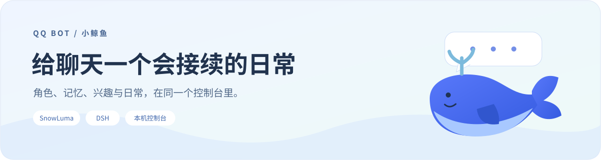
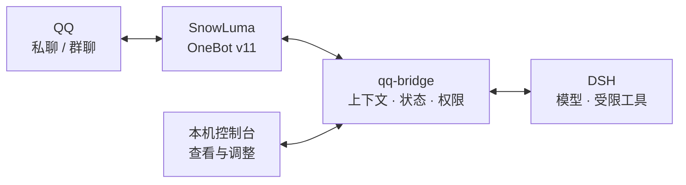
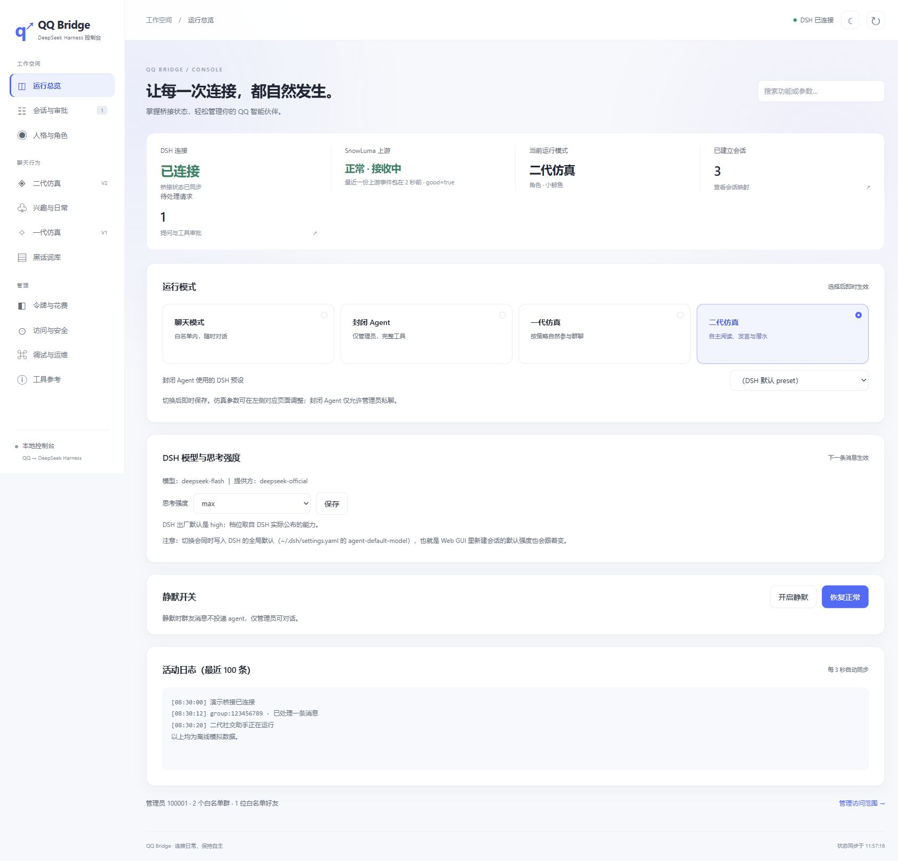
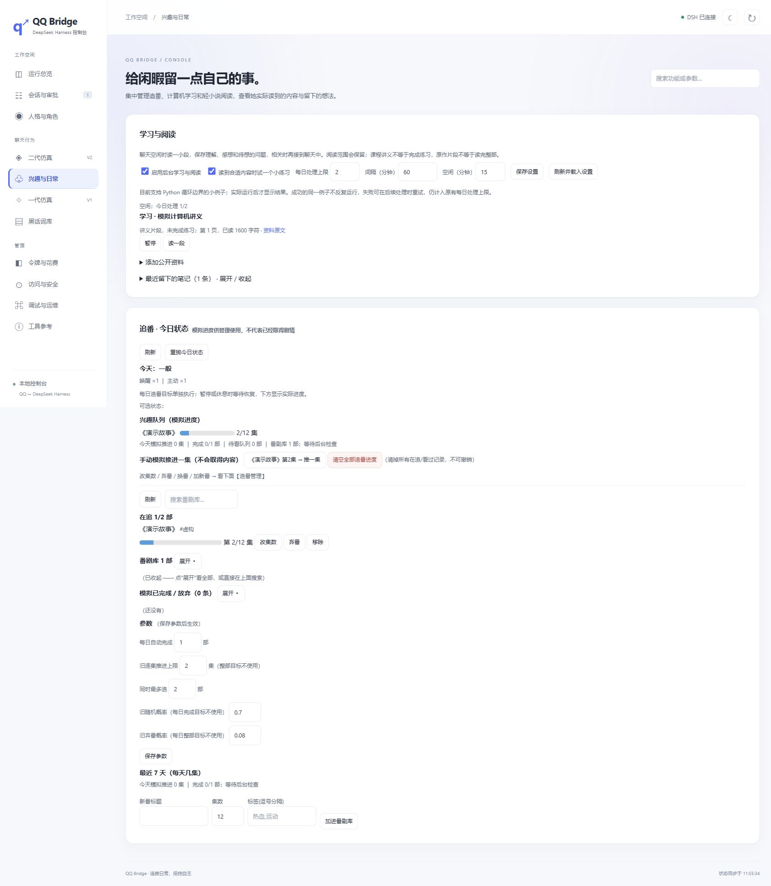

<div align="center">



**让角色有性格，让聊天有接续，让日常有来由。**

连接 **QQ / SnowLuma** 与 **DeepSeek Harness（DSH）** 的本机聊天机器人项目。

[功能一览](#功能一览) · [界面预览](#界面预览) · [快速上手](#快速上手) · [学习与维护](#学习与维护) · [English](README.en.md)


</div>

## 这是什么

小鲸鱼通过 QQ 与人聊天。你可以为她选择角色卡，让她保存称呼、相处约定和话题进展，并在控制台管理表情、兴趣、作息与主动联系。

这个仓库负责**接收消息、组织上下文、约束工具和管理状态**；模型推理由 DSH 执行，QQ 的收发由 SnowLuma / OneBot 提供。它是 [qq-bridge](https://github.com/Derpyu520/qq-bridge) 的维护整理版本，保留上游作者与 MIT 许可。



## 功能一览

| 方向 | 可以做什么 | 主要由什么实现 |
| :--- | :--- | :--- |
| 💬 性格与表达 | 配置角色、口语、幽默、提问与拒绝；使用 Emoji、QQ 小黄豆和收藏图片 | 角色卡、表达提示、发送工具 |
| 🧠 人物与记忆 | 按 QQ 身份记住称呼、约定与话题，接续同一个人的群聊和私聊 | 人物档案、话题记录、作用范围 |
| 🌱 兴趣与日常 | 管理追番、网页阅读、计算机学习、笔记和观点；为闲聊提供材料 | 活动队列、资料读取、笔记与话题转换 |
| 🤝 相处与主动联系 | 查看好感度和关系，在合适的时段接续话题或主动搭话 | 互动记录、作息精力、机会与额度 |
| 🔎 内容与目录 | 解析 B 站分享及可用字幕；查询后端支持的好友、群目录 | 链接解析、读取工具、OneBot API |
| 🎛️ 运行与管理 | 查看连接、模型、角色、令牌花费；配置白名单、暂停与静默 | 本机控制台、状态接口、启动诊断 |

**这些功能仍在持续改进。** 表情频率和聊天自然度受模型影响；跨场景接续保留保密范围。追番进度是模拟推进，阅读与学习只记录实际取得的资料；B 站字幕可用不代表机器人已经看到了视频画面。详见 [功能实现与成熟度](docs/FUNCTIONS.md)。

## 界面预览

下面使用**离线模拟数据**，展示控制台。可以先预览界面，再决定如何连接自己的 QQ 和 DSH。

<details>
<summary><strong>展开查看 · 运行总览</strong></summary>



</details>

<details>
<summary><strong>展开查看 · 兴趣与日常</strong></summary>



</details>

## 快速上手

### 1. 先运行离线预览

需要 **Node.js 24** 和 npm。项目声明最低 Node.js 22.13，本轮实际验收使用 24。

在项目目录运行：

```powershell
npm ci --ignore-scripts --legacy-peer-deps
node scripts/patch-snowluma-sdk.mjs
npm run preview:console
```

打开终端输出的地址即可查看界面。预览不需要 QQ 或 DSH，不发送真实消息；模拟设置在关闭进程后清空。

<details>
<summary>这两个安装参数与修补脚本是做什么的？</summary>

`--legacy-peer-deps` 与锁文件生成时的设置一致，避免重复安装一整套 DSH 的 peer 依赖。`--ignore-scripts` 让安装过程跳过依赖的自动脚本；随后单独运行项目自己的修补脚本，为 SnowLuma npm 包补齐 ESM 导入扩展名。脚本只修改 `node_modules` 内实际存在的目标。

</details>

### 2. 连接自己的机器人

| 顺序 | 操作 | 完成后得到什么 |
| :---: | :--- | :--- |
| ① | 安装并启动 QQ、SnowLuma 与 DSH，完成 QQ 登录和 OneBot 配置 | QQ 与模型服务可用 |
| ② | 将 `config.example.json` 复制为 `config.json`，填写服务地址、token、管理员和允许的好友 / 群号 | 桥接知道连接谁、允许回应谁 |
| ③ | 阅读并运行 `node scripts/setup-dsh.mjs web`，按提示重启 DSH | DSH 加载预设和 MCP 工具 |
| ④ | 执行 `npm start`，或双击 `start.bat` | 启动桥接与本机控制台 |
| ⑤ | 在控制台选择“小鲸鱼”角色和需要的模式 | 开始使用自己的配置 |

控制台默认地址为 [`http://127.0.0.1:3100`](http://127.0.0.1:3100)，使用启动时提示的本机控制台令牌。示例配置的白名单为空，默认拒绝访问，需要填写自己的允许名单。

`setup-dsh.mjs` 会修改本机 DSH profile；运行前阅读脚本并备份 profile。当前适配的是使用 Cookie 鉴权、斜杠 RPC 和 `remote.mux` 的 DSH 协议代次，安装版本还需对账，见 [兼容性说明](docs/VALIDATION.md)。仓库不包含 QQ、SnowLuma 或 DSH 程序。

<details>
<summary><strong>可选 · 配置双击启动和运行检查</strong></summary>

将 `robot-runtime.example.json` 复制为 `robot-runtime.json`，填写自己电脑上的程序路径：

- 双击 **启动机器人.cmd**：检查依赖并启动机器人。
- 双击 **检查机器人.cmd**：查看服务与端口状态。

语音默认关闭，独立 `voice-tool` 未打包；空间与资料的部分写接口尚未完成现场验收。这些扩展需要单独配置和验证。

</details>

## 学习与维护

| 想了解什么 | 从哪里看 |
| :--- | :--- |
| 各种功能怎么实现、哪些还有边界 | [功能实现与成熟度](docs/FUNCTIONS.md) |
| 消息如何经过 QQ、桥接和模型 | [项目结构与数据流](docs/ARCHITECTURE.md) |
| 已验证什么、有什么已知问题 | [验收与兼容性](docs/VALIDATION.md) |
| 如何保存凭据、整理发布文件 | [安全与隐私](SECURITY.md) |
| 修改代码时要遵守什么 | [维护约定](AGENTS.md) |

```powershell
# 检查发布文件，再运行隔离工程测试
npm run release:check
npm run test:portable
```

完整隔离工程测试还需要 **Python 3**，用于实际运行固定的学习练习。默认从 PATH 找到 `python`；也可以通过环境变量 `QQ_BRIDGE_PYTHON` 指定解释器路径。GitHub CI 会准备 Node.js 和 Python；离线控制台预览仅需 Node.js。

本轮本地验收：**40 / 40 组隔离工程测试**、**38 / 38 项模拟控制台浏览器检查**通过。完整安装版本检查为 **40 / 41**，存在已记录的 DSH 工具名对账问题；这些结果不能代替全部真实聊天和外部服务验收。远端 CI 的实际结果请查看仓库 **Actions**。

<details>
<summary><strong>展开查看 · 发布文件与已知维护事项</strong></summary>

源码整理副本排除了 `config.json`、运行状态、Cookie、真实聊天、表情收藏、日志、备份和 `node_modules`。首次发布或自定义角色后仍需人工检查角色卡，通用扫描无法覆盖所有私密自然语言。

`release:check` 优先读取 Git 暂存区，提交前要先暂存本次准备发布的文件；不要直接上传现有运行目录。文件清单见 [RELEASE-MANIFEST.json](RELEASE-MANIFEST.json)。

`bridge.js` 仍有历史重复实现和较大的单文件，后续会逐步拆分。安装的 DSH 工具名检查未找到 `dsh_snapshot`、`dsh_rollback`、`incident_resolved`，对应守卫和检查保留；完整结论见验收文档。

</details>

## 致谢与许可

基于 [Derpyu520/qq-bridge](https://github.com/Derpyu520/qq-bridge) 持续维护，保留上游版权与第三方组件说明，使用 [MIT 许可](LICENSE)。SnowLuma 和 DeepSeek Harness 是独立依赖，请遵循各自的使用与许可要求。
